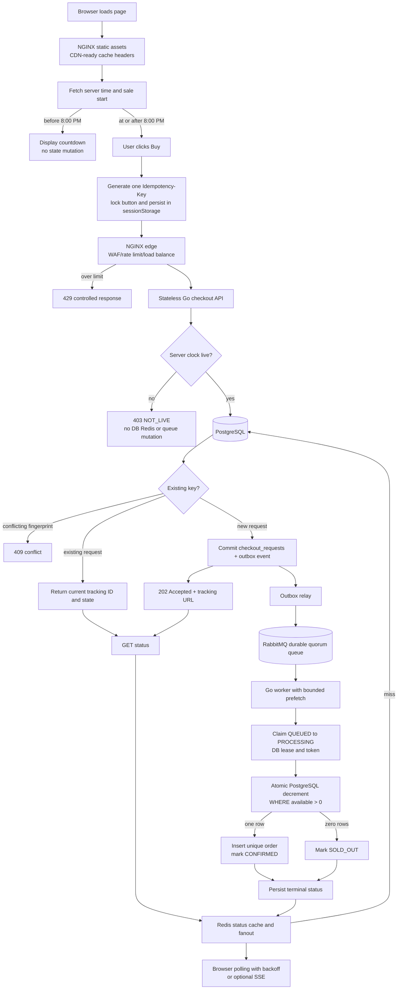

# Flash Sale

This repository implements the flash-sale take-home: 500 smartphones, a server-authoritative 8:00 PM launch, and more than 100,000 checkout attempts in the first 10 seconds. PostgreSQL is the durable authority, Redis is coordination and cache, RabbitMQ is the durable business queue, Go provides the API and workers, and NGINX is the local CDN and edge stand-in.

## End-to-end flow



## Sequential resolution of the PDF requirements

1. **The invariant is defined first.** The sale has exactly 500 units. The only valid terminal inventory result is zero through 500 confirmed orders; inventory must never become negative. The database conditional decrement, the non-negative constraint, and the unique order constraint enforce this independently of client behavior, queue duplication, or worker count.

2. **The 8:00 PM boundary is server controlled.** The browser countdown is informational. Every checkout request is checked against `SALE_START` using server time. Before launch the API returns `403 NOT_LIVE` and does not create an idempotency row, Redis token, outbox event, or queue message. A client with a wrong clock cannot open the sale early.

3. **The page is kept light.** NGINX serves the static page with compression and long-lived cache headers, representing the CDN layer required by the assignment. The sale path uses vanilla TypeScript and no framework runtime. The intended production gate is a measured bundle below 200 KB and a mobile TTI below 1.5 seconds; these are benchmark gates, not claims made from the source size alone.

4. **The first click is made safe in the browser.** The button is disabled immediately, one UUID idempotency key is generated, and the key plus tracking ID are stored in `sessionStorage` for refresh recovery. A retry reuses the same key. The key is sent in the `Idempotency-Key` header; cookies are not the correctness mechanism.

5. **The edge absorbs abusive traffic.** NGINX applies per-IP request limiting, request-size controls, compression, static caching, and proxy routing. API replicas are stateless and can be multiplied behind an active-active production load balancer. A controlled `429` is observable as throttled, not silently dropped. The local NGINX configuration is the take-home stand-in for a CDN, WAF, and managed load balancer.

6. **The checkout API does no inventory work.** It validates the product, quantity, user, key, fingerprint, and sale window. A new request inserts `checkout_requests` and `outbox_events` in one PostgreSQL transaction. The API returns `202 Accepted` only after that commit, with a tracking ID and status URL. `202` means accepted for asynchronous processing, never confirmed ownership.

7. **Idempotency survives retries.** PostgreSQL enforces unique `(user_id, idempotency_key)` and stores a request fingerprint. The same key with the same payload returns the existing state; the same key with different input returns `409`. This handles rapid clicks, timeout retries, refreshes, duplicate HTTP deliveries, and duplicate queue messages without creating a second order.

8. **The transactional outbox closes the database/queue gap.** The committed request and its `CHECKOUT_REQUESTED` event cannot be split. A relay publishes pending events to RabbitMQ and marks them published after publication. Relay retries and duplicate publication are expected; the worker remains idempotent. The outbox does not itself confirm stock or provide exactly-once delivery.

9. **RabbitMQ is the one durable business queue.** The queue is durable and quorum-backed, messages are persistent, consumers use manual acknowledgements and prefetch, and failures are retried. Broker capacity and worker capacity are separate: the broker absorbs bursts, while worker concurrency is capped by PostgreSQL inventory-row capacity. A worker acknowledges only after the terminal database transaction commits, so a crash before acknowledgement causes safe redelivery.

10. **The worker claims ownership in PostgreSQL.** The request state is changed from `QUEUED` to `PROCESSING` with a lease/token in the durable database. Duplicate deliveries see a non-`QUEUED` state and do not process the inventory again. Redis locks are deliberately not the correctness mechanism because expiry and failover can create ownership ambiguity.

11. **The inventory decision is one short ACID transaction.** The worker executes `UPDATE inventory SET available = available - 1 WHERE product_id = $1 AND available >= 1`. One affected row means insert the uniquely keyed order and mark `CONFIRMED`; zero rows means mark `SOLD_OUT`. Concurrent workers serialize on the inventory row. Deadlock, serialization, and connection failures are retryable; a committed terminal state is acknowledged exactly once from the application's point of view.

12. **Status reads do not hammer PostgreSQL.** Terminal state is persisted in PostgreSQL and copied to Redis with a TTL. The status endpoint reads Redis first and falls back to PostgreSQL on a miss, so Redis restart or cache loss cannot erase the result. The baseline browser mechanism is jittered exponential polling. SSE is an optional separately scalable fanout service; it must read cached state and events rather than poll PostgreSQL once per connection.

13. **The load model is explicit.** The PDF's 100,000 requests in 10 seconds is approximately 10,000 requests per second at the edge. The expected behavior is admission and throttling at NGINX, fast durable request acceptance at stateless Go replicas, queue buffering in RabbitMQ, bounded settlement in PostgreSQL, and cache-served status reads. The local benchmark reports actual results; it does not claim that a laptop equals production capacity.

## Run

```sh
docker compose up --build
```

The local edge is `http://localhost:8080`. The API returns `403 NOT_LIVE` until `SALE_START`; set it to an ISO timestamp for a test window. `POST /api/v1/checkout` requires `X-User-ID`, `Idempotency-Key`, and `{"product_id":"phone-500","quantity":1}`.

## Verification

```sh
go test ./...

# After Docker services are running, run the PDF-shaped burst test.
go run ./cmd/loadtest -url http://localhost:8080/api/v1/checkout -requests 100000 -duration 10s -concurrency 512
```

The database migration enforces non-negative stock, one order per checkout request, and durable idempotency. The worker acknowledges RabbitMQ only after the terminal PostgreSQL transaction commits.

## Benchmark evidence

The repository now contains `cmd/loadtest`, which sends 100,000 requests over a 10-second window and reports served, throttled, failed, elapsed time, and achieved request rate. On this run, Docker Desktop was unavailable, so the services could not be started and no valid end-to-end throughput number was measured. The 10,000 RPS figure therefore remains the assignment target, not a claimed local result. Run the command above on a machine with Docker running and record its output here before claiming the target is achieved.
