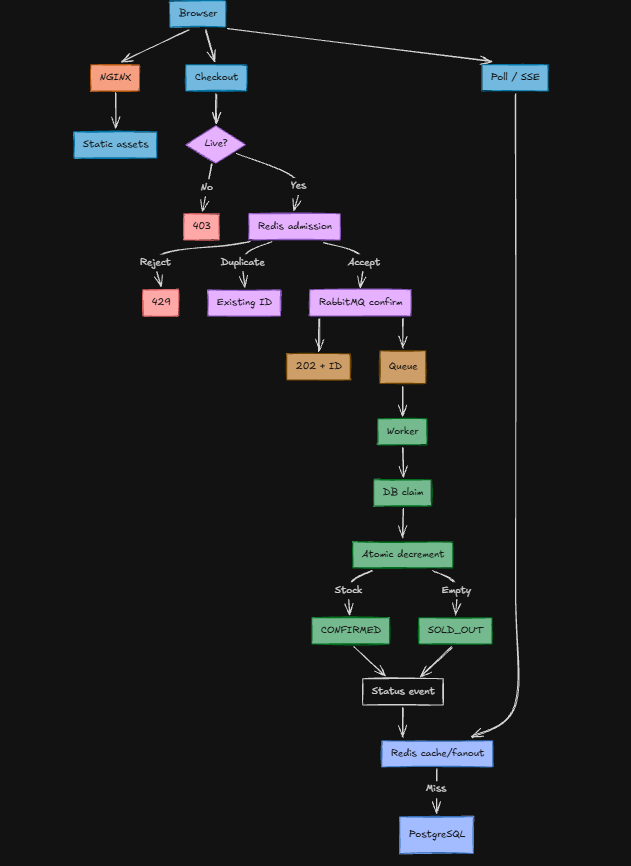

# Flash Sale System

## Overview

This repository implements a flash-sale checkout system:

- 500 smartphones become available at 8:00 PM.
- More than 100,000 checkout requests can arrive during the first ten seconds.
- At most 500 orders can reach `CONFIRMED`.
- Inventory cannot become negative.
- Accepted checkout requests are durable and idempotent.

The local deployment launched 100,000 requests through NGINX, accepted all 100,000 with publisher-confirmed `202` responses, produced no throttles or transport/server failures, and settled exactly 500 orders as confirmed.

## Contents

- [Checkout State Machine](#checkout-state-machine)
- [Design Decisions](#design-decisions)
- [Architecture](#architecture)
- [Request Flow](#request-flow)
- [State and API Contracts](#state-and-api-contracts)
- [Autoscaling and Routing](#autoscaling-and-routing)
- [Measured Results](#measured-results)
  - [Load Test Method](#load-test-method)
  - [Correctness](#correctness)
  - [Launch Burst](#launch-burst)
  - [Frontend](#frontend)
- [Run](#run)

## Checkout State Machine

Every accepted request follows one durable state path:

```text
QUEUED -> PROCESSING -> CONFIRMED
                     -> SOLD_OUT
                     -> FAILED
```

`QUEUED` means RabbitMQ accepted the job. `PROCESSING` is owned by a PostgreSQL lease and processing token. `CONFIRMED`, `SOLD_OUT`, and `FAILED` are terminal states. Duplicate requests and redelivered messages resolve to the same request state and cannot create a second order.

## Design Decisions

| Decision | Choice | Reason |
|---|---|---|
| API | Go `net/http` | Small stateless handlers and predictable concurrency. |
| Edge | NGINX | Static delivery, request limits, rate limiting, least-connection routing, and local load-balancer behavior. |
| Durable state | PostgreSQL 16 | ACID transactions, unique idempotency keys, and atomic inventory settlement. |
| Fast coordination | Redis 7 | Atomic Lua admission, rate limits, short-lived tickets, status cache, and fanout. Redis is not the order authority. |
| Business queue | RabbitMQ quorum queue | Durable messages, publisher confirms, manual acknowledgements, retries, and dead-lettering. |
| Status | HTTP polling by default, SSE optional | Polling keeps the client path simple; SSE is separately scalable through Redis fanout. |
| Inventory operation | Conditional SQL decrement | One database operation prevents lost updates and negative stock. |
| Scaling | Four pre-scaled API replicas plus Go autoscaler | The launch time is known; pre-scaling handles the first burst and autoscaling handles pressure and recovery. |

Pessimistic row locks would serialize the hot inventory row and increase lock waits. Optimistic version checks would require retries under the same contention. The selected conditional update lets PostgreSQL perform the lock and decrement atomically. Redis Lua provides the same atomicity for admission, but Redis cannot decide final ownership of inventory.

## Architecture

<p align="center">
  
</p>

The diagram is a compact overview. Checkout and status requests both traverse the NGINX edge before reaching the API; status reads then use Redis first and PostgreSQL on a cache miss.

## Request Flow

1. The browser loads static assets through NGINX. Immutable cache headers make the route CDN-ready and keep static traffic away from checkout traffic. `/api/v1/time` returns the server sale timestamp. The countdown is display-only.

2. Before the sale opens, the Buy button is disabled. At the first valid click the browser disables it immediately, creates one UUID idempotency key, and stores the key and tracking ID in `sessionStorage` for refresh and retry recovery.

3. `POST /api/v1/checkout` carries `Idempotency-Key`, `X-User-ID`, product ID, and quantity. NGINX applies request-size limits and edge rate limiting. Excess traffic receives `429 Retry-After`.

4. The API checks the server sale window before Redis. Redis Lua atomically validates the sale window, consumes rate-limit capacity, enforces the bounded admission counter, and creates a short-lived idempotency hint. Admission is not an order and is not a second durable queue.

5. For a new key, the API publishes a persistent RabbitMQ message and waits for publisher confirmation. Only then does it return `202 Accepted` with a tracking ID and status URL. If publishing fails, it returns `503` and releases the temporary admission ticket. A same-key retry returns the original tracking ID; a different payload returns `409 Conflict`.

6. A worker consumes the durable message. It inserts the PostgreSQL request row with `ON CONFLICT`, compares the request fingerprint, claims `QUEUED -> PROCESSING` with a processing token and lease, and ignores duplicate terminal work.

7. The settlement transaction is:

```sql
BEGIN;

UPDATE inventory
SET available = available - 1
WHERE product_id = $1 AND available > 0;

-- one affected row: insert unique order and mark CONFIRMED
-- zero affected rows: mark SOLD_OUT
-- both paths write terminal result and status outbox event

COMMIT;
```

The RabbitMQ message is acknowledged only after this commit. A worker crash before acknowledgement causes redelivery. A crash after commit is harmless because request and order uniqueness constraints make the retry a no-op. Expired leases can be reclaimed and stale processing tokens cannot commit.

8. The status event updates Redis cache and fanout. The browser polls with exponential backoff and jitter. SSE sends the cached initial state, event IDs, fanout updates, and heartbeats; an SSE error closes the stream and falls back to polling. Terminal states stop both mechanisms.

## State and API Contracts

```text
QUEUED -> PROCESSING -> CONFIRMED
                     -> SOLD_OUT
                     -> FAILED
```

```http
POST /api/v1/checkout
Idempotency-Key: <uuid>
X-User-ID: <user>
Content-Type: application/json

{"product_id":"phone-500","quantity":1}
```

```http
GET /api/v1/checkout-status/:trackingId
GET /api/v1/checkout-status/:trackingId/stream
GET /api/v1/time
GET /api/v1/admin/audit
GET /healthz
GET /readyz
GET /metrics
```

`202` means the message is durably accepted by RabbitMQ. It never means that inventory has been confirmed.

## Autoscaling and Routing

`cmd/autoscaler` is a host-side Go controller for the Compose deployment. It keeps four to eight API replicas, scales up by two when CPU exceeds 50% or queue pressure crosses the configured threshold, and waits 60 seconds before scaling down. It checks Docker health and `/readyz`, writes healthy container addresses to `nginx-upstream.conf` using an atomic replacement, reloads NGINX, and drains removed replicas before stopping them.

The local controller is the Compose equivalent of a production Kubernetes HPA or ECS service-autoscaling policy. Four replicas are started before the known launch. The API is stateless; checkout state is held in Redis, RabbitMQ, and PostgreSQL.

## Measured Results

### Load Test Method

The launch test uses five Docker load-generator containers. Each generator creates 20,000 unique users and idempotency keys, opens up to 400 keep-alive connections, and starts against the same synchronized timestamp. All requests go through NGINX to the four API replicas.

The generator records every request before launch and classifies every result as `202`, `429`, controlled rejection, `5xx`, timeout, connection failure, or in-flight. The launch counter is independent of response completion, so the ten-second requirement measures actual dispatch rather than worker availability. The aggregate report combines the five raw logs and separately reports accepted work, throttled traffic, failures, and silent drops.

The correctness test is separate: 550 unique requests are sent against 500 units to verify exactly 500 confirmations and 50 sold-out results. The launch profile has no artificial 2,000-request global cap; all valid burst requests are admitted to RabbitMQ, while inventory settlement still limits confirmations to 500.

Together, these tests cover the launch burst, controlled admission, zero silent loss, asynchronous processing, and the 500-unit inventory invariant.

### Correctness

The 550-request run completed 550/550 requests with zero client failures:

```text
CONFIRMED: 500
SOLD_OUT:   50
inventory:   0
negative:    0
```

### Launch burst

The latest five-generator run used distinct source containers and sent traffic through NGINX:

```text
launched within ten seconds: 100,000
responses completed:         100,000
accepted with 202:           100,000
controlled 429 responses:          0
5xx, timeouts, connections:       0
maximum launch time:            4.289 s
maximum collection time:       65.648 s
database after queue drain: 500 CONFIRMED, 99,500 SOLD_OUT, inventory 0
```

The raw generator logs are in `outputs/benchmarks/`. The launch window measures dispatch; response collection continues while RabbitMQ publisher confirms and the API completes the accepted work. No request was silently lost.

### Frontend

The final Vite bundle is 3,876 bytes transferred in the Lighthouse runs. Three cold mobile runs using a 390x844 viewport, 4x CPU slowdown, and simulated 150 ms latency reported:

```text
TTI: 1,189 ms, 1,185 ms, 1,190 ms
FCP:   627 ms,   633 ms,   641 ms
```

The worst TTI is below the 1.5-second target. Raw reports are in `outputs/benchmarks/lighthouse/`.

## Run

```bash
docker compose up -d --build
docker compose up -d --scale api=4 api nginx worker
go test ./...
```

Run the measured tests:

```powershell
./scripts/distributed_load.ps1 -Generators 5 -RequestsPerGenerator 20000 -Concurrency 400 -DurationSeconds 10
./scripts/lighthouse-mobile.ps1 -Runs 3
go run ./cmd/autoscaler -once -dry-run
```

