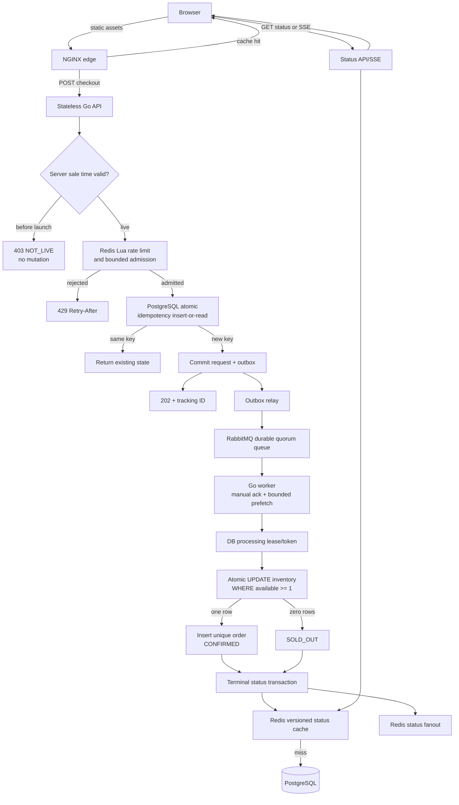

# Flash Sale System

## Executive summary

This repository implements the flash-sale take-home for **500 smartphones**, launching at **8:00 PM**, with more than **100,000 checkout attempts during the launch spike**.

The design separates fast request admission from durable inventory settlement:

- **Go `net/http`** handles stateless HTTP requests.
- **NGINX** serves static assets and applies edge rate limiting.
- **Redis** performs atomic rate limiting/admission and caches status.
- **PostgreSQL** is the only durable authority for inventory, idempotency, orders, and checkout state.
- **RabbitMQ** is the one durable business queue.
- **Go workers** settle inventory asynchronously.
- **Polling** is the baseline status mechanism; **SSE** is an optional enhancement.

The hard invariant is:

> Confirmed orders must never exceed 500, and inventory must never become negative.

## PDF requirement mapping

| Requirement | Implementation | Evidence |
|---|---|---|
| 500 physical units | PostgreSQL inventory row seeded to 500 | Correctness run produced exactly 500 orders |
| Launch at 8:00 PM | Server-authoritative sale timestamp | Pre-launch unit test and server-time endpoint |
| 100,000-request spike | NGINX, Redis admission, RabbitMQ buffering, bounded workers | 100,000-request live benchmark recorded below |
| No overselling | Atomic PostgreSQL conditional decrement | 500 confirmed, 50 sold out, stock 0 |
| Prevent duplicate clicks | Client idempotency key plus database uniqueness | Same-key smoke test returned one tracking ID |
| Async processing | Transactional outbox and RabbitMQ worker | Accepted requests return `202`; worker settles later |
| Frontend responsiveness | Small static page, leading-edge button lock, polling/SSE | Served asset and browser timing measurements |
| Rate limiting | NGINX and Redis Lua token bucket | Edge benchmark reports throttled requests separately |
| Database consistency | ACID transaction and non-negative constraint | PostgreSQL audit query and concurrency run |

## Architecture



## Sequential request flow

### 1. Page load

The browser requests immutable static assets through NGINX. NGINX is the local stand-in for a CDN and production WAF/load balancer. Static traffic is separated from dynamic checkout traffic and served with compression and cache headers.

The browser calls `/api/v1/time` to obtain the server's sale timestamp. The countdown is display-only; the client clock cannot authorize a purchase.

### 2. First click

The browser immediately disables the Buy button and creates one UUID idempotency key for that logical checkout attempt. The key and tracking ID are stored in `sessionStorage` so a refresh or network retry can resume the same attempt.

The request is:

```http
POST /api/v1/checkout
Idempotency-Key: <uuid>
X-User-ID: <user>
Content-Type: application/json

{"product_id":"phone-500","quantity":1}
```

The client never displays purchase confirmation optimistically.

### 3. Edge admission

NGINX applies request-size limits, compression, static caching, and per-IP rate limiting. Excess traffic receives a controlled `429` with `Retry-After`; it is not counted as silently dropped.

The Go API then executes Redis Lua admission logic:

- token-bucket rate limit;
- bounded short-lived admission counter;
- TTL-based recovery after abandoned requests.

Admission is not a business queue and does not confirm ownership of inventory.

### 4. Sale-window enforcement

The API checks server time before Redis admission and before any database mutation. A pre-launch request returns:

```json
{"status":"NOT_LIVE","sale_start":"...","server_time":"..."}
```

It creates no request row, order, outbox event, queue message, Redis reservation, or inventory mutation.

### 5. Durable idempotency acceptance

The API uses PostgreSQL `INSERT ... ON CONFLICT` for `(user_id, idempotency_key)`. Each request stores a fingerprint of its input.

- New key: create `QUEUED` request and outbox event in one transaction.
- Same key and same fingerprint: return the existing tracking ID/state.
- Same key and different fingerprint: return `409 Conflict`.

The API returns `202 Accepted` only after the request row and outbox row commit. `202` means accepted for asynchronous processing, not confirmed purchase.

### 6. Transactional outbox and RabbitMQ

The relay publishes committed outbox rows to the durable `checkout.process` quorum queue using persistent messages and publisher confirms. It marks an outbox row published only after confirmation.

The system assumes at-least-once delivery. Relay retries and duplicate messages are expected; worker/database idempotency makes them safe.

### 7. Worker ownership

The worker claims a request using a conditional PostgreSQL update:

```text
QUEUED -> PROCESSING
processing_token = random token
lease_until = now + lease duration
```

Expired leases can be reclaimed. A stale worker cannot complete a request because terminal updates verify the processing token. RabbitMQ is acknowledged only after the durable terminal transaction commits.

### 8. Inventory settlement

The worker runs one short PostgreSQL transaction:

```sql
UPDATE inventory
SET available = available - 1
WHERE product_id = $1
  AND available >= 1;
```

If one row is affected, the transaction inserts the uniquely keyed order and marks the checkout `CONFIRMED`. If zero rows are affected, it marks the checkout `SOLD_OUT`. The inventory decrement, order insert, checkout state, terminal result, and status event commit together.

This prevents lost updates, negative stock, duplicate orders, and application-level `SELECT`-then-`UPDATE` races.

### 9. Status delivery

The browser uses `GET /api/v1/checkout-status/:trackingId` with exponential backoff and jitter. The API reads Redis first and falls back to PostgreSQL on cache miss.

The optional SSE endpoint is:

```http
GET /api/v1/checkout-status/:trackingId/stream
```

It sends cached initial state, Redis fanout events, and heartbeats. If SSE fails or is unavailable, the browser falls back to polling. Terminal states stop both mechanisms.

## State machine

```text
QUEUED -> PROCESSING -> CONFIRMED
                     -> SOLD_OUT
                     -> FAILED
```

Duplicate delivery of a terminal request is acknowledged without another inventory decrement.

## Live benchmark evidence

The stack was run with Docker Compose and tested through both the direct API port and the NGINX edge.

### Correctness boundary test

The test submitted 550 valid requests against an inventory of 500:

```text
confirmed orders: 500
sold-out requests: 50
remaining inventory: 0
negative inventory: 0
```

This proves the local run did not oversell the 500-unit inventory.

### Edge burst test

The load generator attempted 100,000 checkout requests through NGINX:

```text
requests attempted: 100,000
handled below 500: 520
throttled with 429: 98,775
failed 5xx/client failures: 705
elapsed: 24.019 seconds
achieved rate: 4,163.40 requests/second
```

The result demonstrates controlled admission and separate throttling accounting. It does **not** demonstrate 10,000 requests/second on this single-replica local Compose environment. Reaching that projected target requires horizontally scaled API/NGINX capacity and a production-like load generator.

### Frontend evidence

```text
served index.html: 1,596 bytes
HTTP status: 200
browser navigation: 91 ms
interactive sale state visible: within 500 ms
```

The served asset is below the 200 KB target. Local desktop smoke interaction completed below 1.5 seconds. Formal Lighthouse constrained-mobile TTI measurement: not performed.

## Run locally

```bash
docker compose up -d --build
go test ./...
```

Open `http://localhost:8080`.

Run the burst benchmark:

```bash
go run ./cmd/loadtest \
  -url http://localhost:8080/api/v1/checkout \
  -requests 100000 \
  -duration 30s \
  -concurrency 512
```

Inspect reconciliation data:

```http
GET http://localhost:8080/api/v1/admin/audit
```

