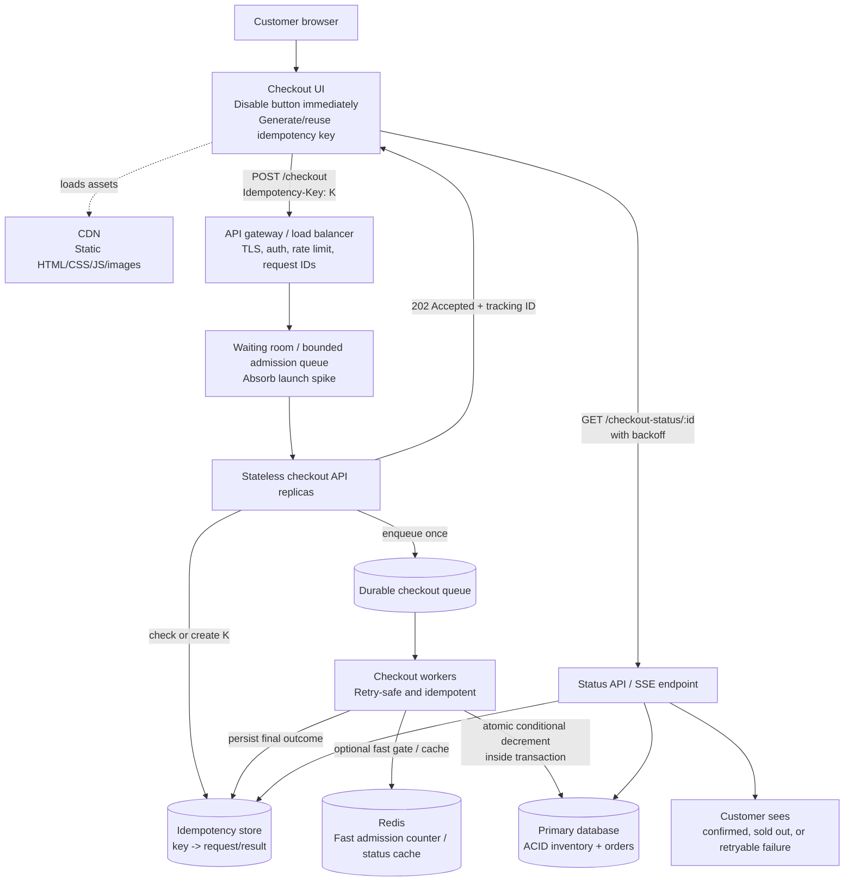
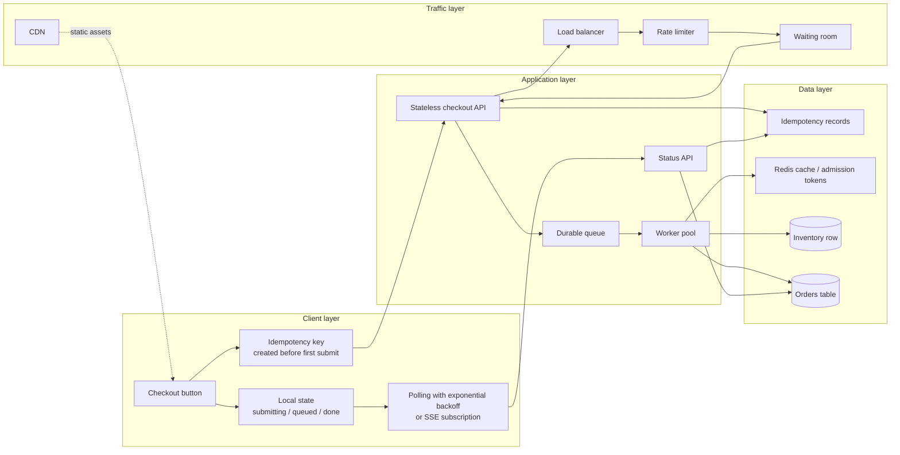
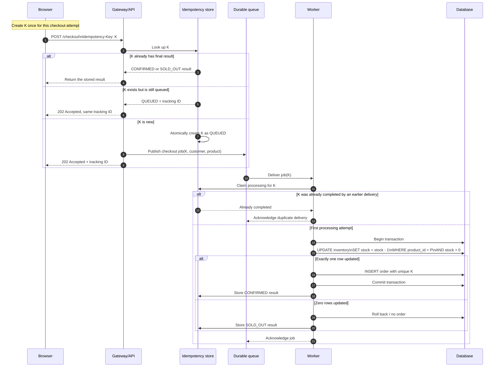
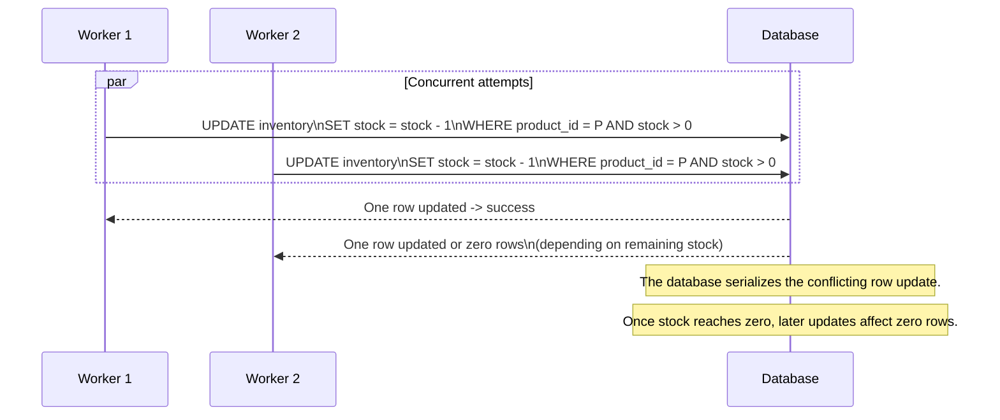
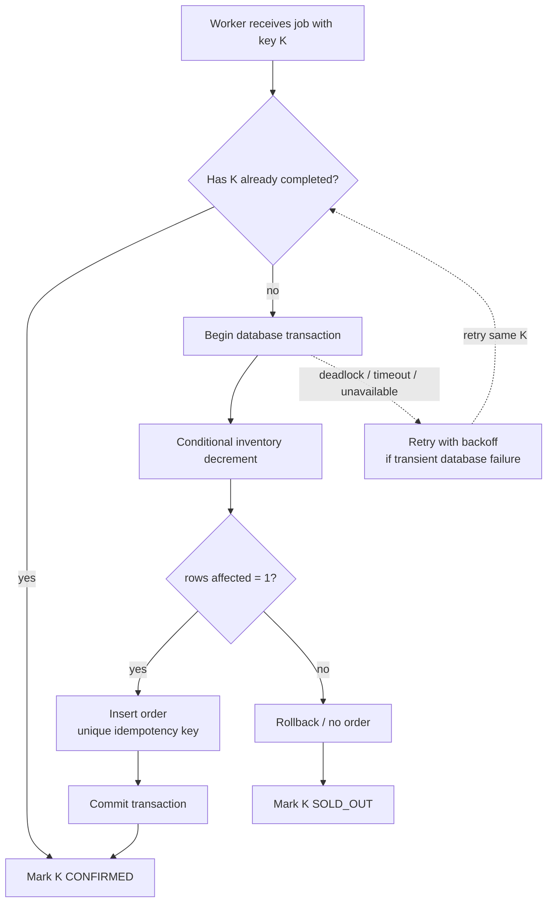
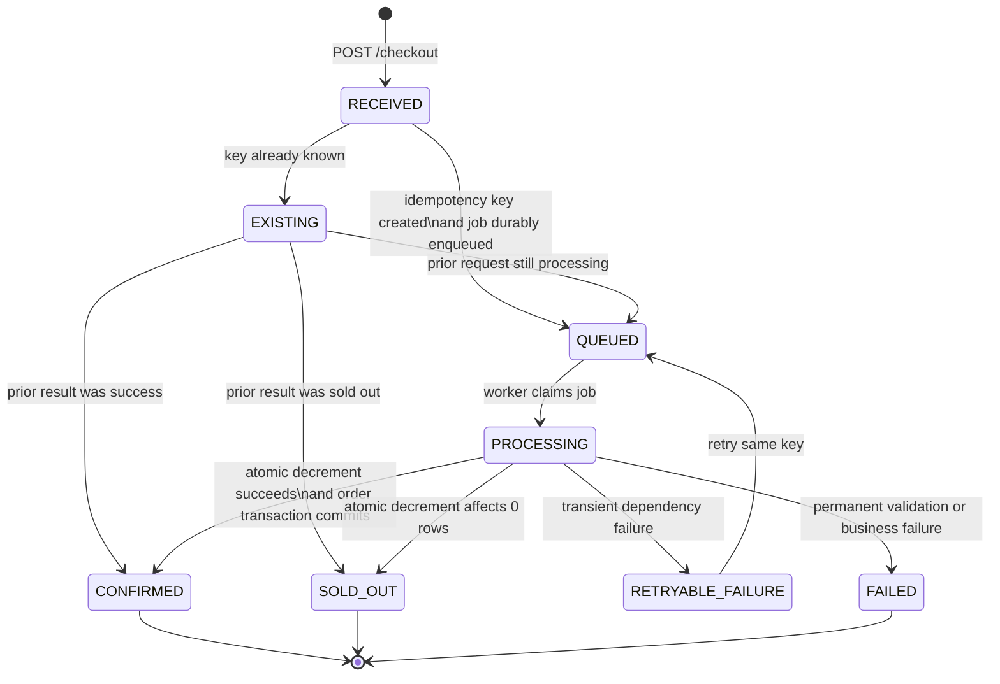
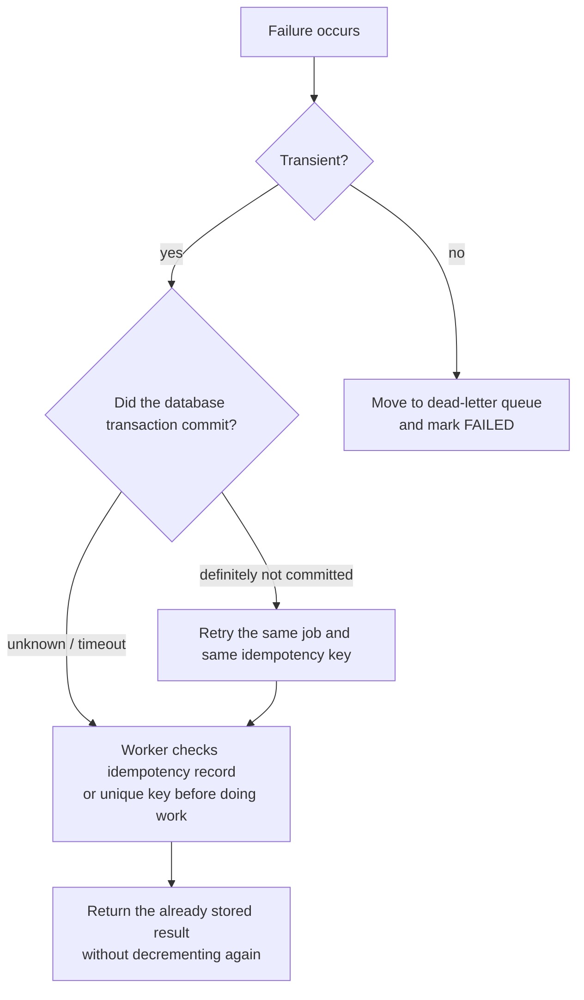
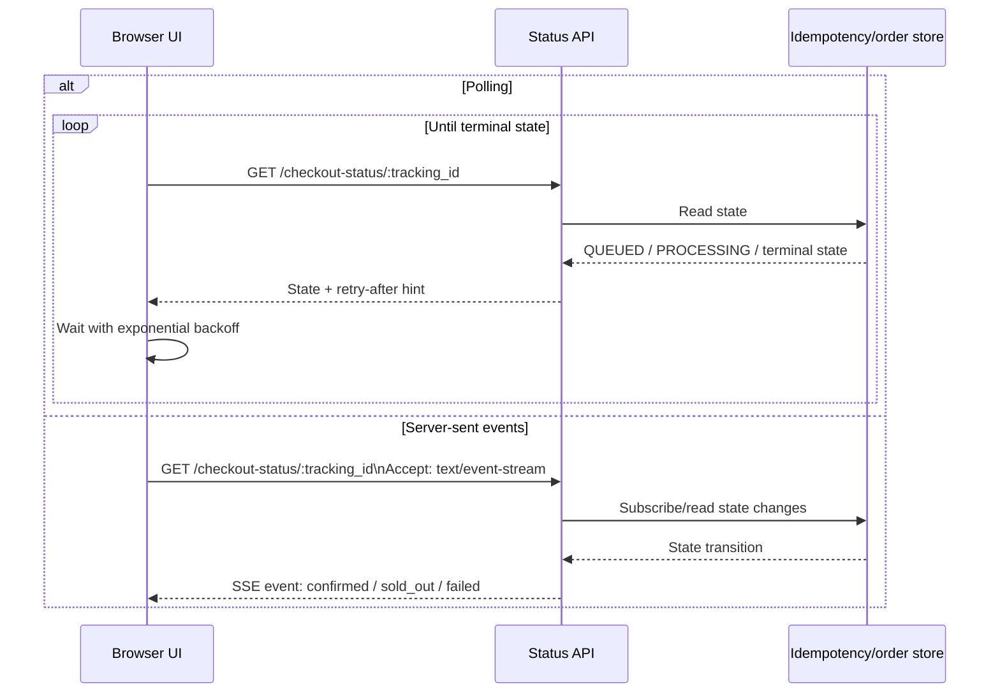
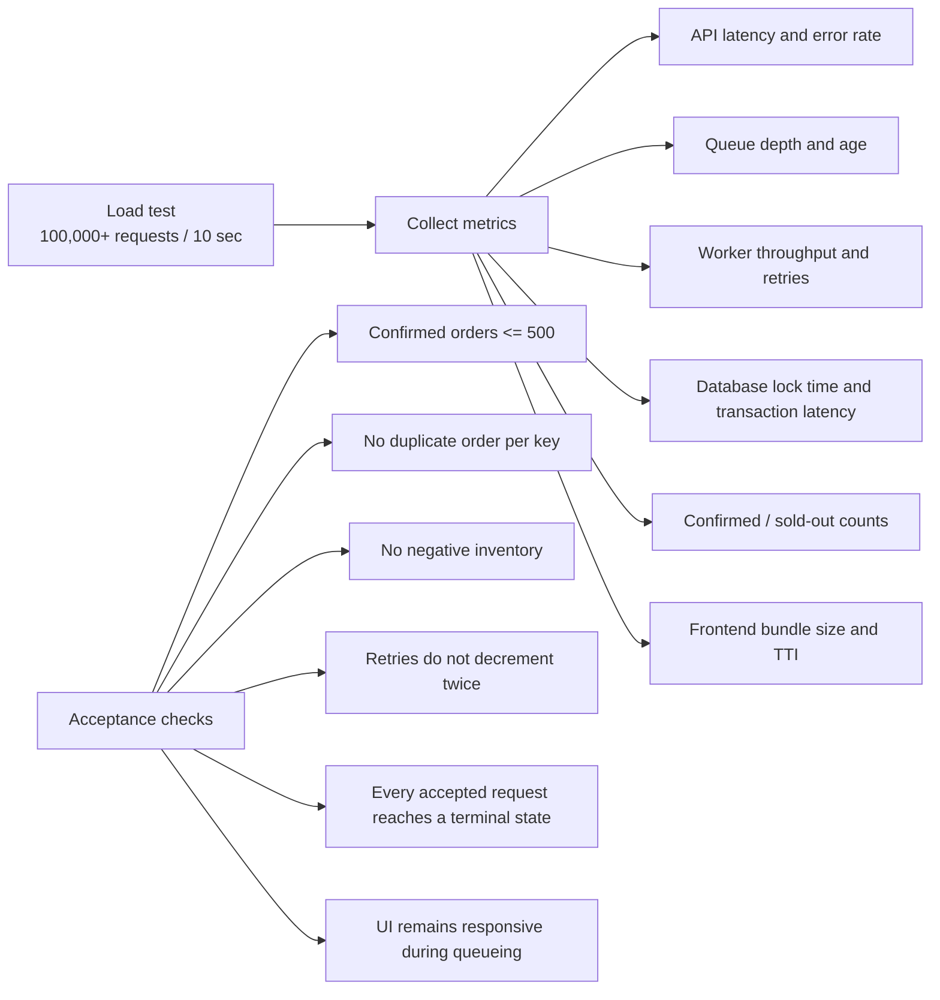

# Flash Sale Architecture

This design handles a launch spike of more than 100,000 checkout requests for 500 phones while preserving one hard invariant:

> At most 500 orders can reach `CONFIRMED`.

The browser, gateway, queue, Redis, workers, and database each have a different job. The database transaction is the final authority for durable inventory ownership.

## 1. End-to-end request flow



### Meaning of `202 Accepted`

`202 Accepted` means the request was accepted for processing. It does not mean the phone has been purchased. The final result is returned through the status endpoint or an SSE update.

## 2. Component responsibilities



## 3. The idempotency-key path

The key prevents duplicate orders when the customer double-clicks, the browser retries, or the client times out after the server has already accepted the request.



## 4. Inventory correctness transaction

The dangerous version is:

```sql
SELECT stock FROM inventory WHERE product_id = :product_id;
-- application checks stock > 0
UPDATE inventory SET stock = stock - 1 WHERE product_id = :product_id;
```

Two workers can read the same stock value before either update. The safe version makes the check and decrement one database operation.



The worker must check the affected-row count. A successful SQL statement is not enough: `rows_affected = 1` means inventory was claimed; `rows_affected = 0` means sold out.

## 5. Transaction boundary



The order insert should have a unique constraint on the idempotency key. That database constraint is a second line of defense against duplicate message delivery.

## 6. Order state machine



## 7. Failure and retry behavior



Examples of transient failures: database connection reset, queue delivery timeout, or a worker crash. The safe retry rule is always: reuse the same idempotency key and make the worker check whether the operation already completed.

## 8. Polling or SSE status updates



Polling is simpler to implement and sufficient for a take-home. SSE is a good upgrade when the product wants near-real-time one-way updates. WebSockets are useful when the connection must support two-way interaction, but they add more connection-management complexity.

## 9. Decisions to state explicitly in the submission

1. The database is the durable source of truth for confirmed inventory.
2. Redis may reduce admission pressure or provide fast temporary state, but Redis alone does not prove durable order ownership.
3. Every checkout carries an idempotency key, and the key has a unique database constraint.
4. The checkout API returns `202 Accepted` while work is queued.
5. The worker uses one atomic conditional decrement and checks the affected-row count.
6. Queue delivery is treated as at-least-once, so duplicate messages are expected and safe.
7. The browser disables repeated submission and reuses the same key on retry.
8. A waiting room or bounded queue protects the database from the 100,000-request burst.
9. Rate limiting protects against abusive clients; it does not provide inventory correctness.
10. Load tests must verify that no more than 500 orders become `CONFIRMED` under concurrency.

## 10. Metrics and acceptance checks



The PDF's frontend targets are a bundle below 200 KB and Time to Interactive below 1.5 seconds. Validate those with the chosen build and deployment setup. Validate backend targets with a realistic burst test rather than relying on a static capacity estimate.

